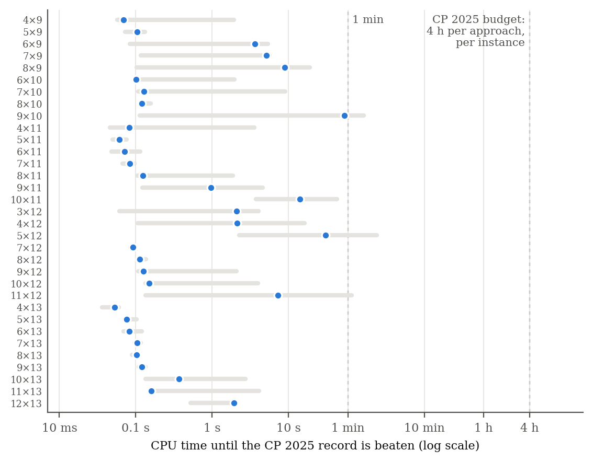
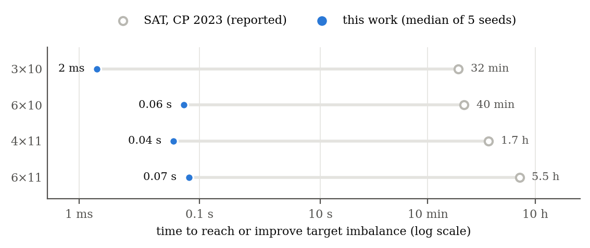

# Balanced Latin Rectangles: improved published upper bounds

A simple simulated-annealing search improves **33 of the 51** non-square instances
in Table 1 of [Voboril, Peruvemba Ramaswamy & Szeider, CP 2025](https://doi.org/10.4230/LIPIcs.CP.2025.36)
and matches the other 18. Every rectangle is included and can be checked independently.
“Record” below refers to that reference table, not an exhaustive priority claim.

Paper: [`paper/main.pdf`](paper/main.pdf) — *Simple Local Search Improves 33 Published Upper Bounds for Balanced Latin Rectangles*.

<!-- RESULTS:START -->

## Results

**33 improved, 18 matched, 0 worse** out of 51 instances. Across the improved instances, reductions average **18.5%** and reach **39.4%** (12×13: 274.0 → 166.0). Previous values are from Table 1 of CP 2025; all new values are verified by `code/verify.py`.

### First-improvement timing

These times do not measure attainment of the final table values, which use up to 16 allocated CPU minutes per instance. Cross-study times are not controlled speedups.

In the historical first-improvement experiment on the 33 improved instances, with 5 seeds per instance, each stopping as soon as it beats the CP 2025 record, the **pooled median over all 165 runs is 0.12 s** of CPU time on one laptop core, and **every run beats it within 2.4 min**. The CP 2025 pipeline spends at least 4 hours per instance per approach (after a 4-hour Gurobi baseline), on 10-core servers.



*CPU time until the search beats the CP 2025 record: median (dot) and range (bar) over 5 seeds, log scale. The dashed line marks a CP 2025 four-hour budget, not time to the reference quality.*

The SAT approach of CP 2023 reports solving times for four rectangles. The search reaches or improves the target imbalance in under a tenth of a second:



| instance | imbalance | SAT, CP 2023 (reported) | this work (median of 5) | this work (slowest) |
|---|---:|---:|---:|---:|
| 3 × 10 | 84 | 32 min | 2 ms | 3 ms |
| 6 × 10 | 96 | 40 min | 0.06 s | 0.07 s |
| 4 × 11 | 118 | 1.7 h | 0.04 s | 0.04 s |
| 6 × 11 | 124 | 5.5 h | 0.07 s | 0.07 s |

*Caveats: different hardware (Xeon E5-2640 v4 servers vs. an Apple M3 laptop; no hardware calibration was performed; ), CP 2025 does not report when within its runs each record was found, and we did not rerun either pipeline. See the paper for details.*

### At a glance


*New best imbalance per cell (bold, k across, n down) with the previous best below it, shaded by the reduction relative to the previous best. Grey cells match the previous value.*

### Full table

**Bold** = new best value from this work, with the previous best struck through. Plain = matched. Columns are k (rows of the rectangle), rows are n (symbols).

| n \ k | 2 | 3 | 4 | 5 | 6 | 7 | 8 | 9 | 10 | 11 | 12 |
|---:|:---:|:---:|:---:|:---:|:---:|:---:|:---:|:---:|:---:|:---:|:---:|
| **8** | 40.0 | 36.0 | 32.0 | 30.0 | 24.0 | 28.0 |  |  |  |  |  |
| **9** | 65.3 | 56.0 | **53.3** ~~56.0~~ | **48.6** ~~52.6~~ | **40.0** ~~48.0~~ | **43.3** ~~51.3~~ | **42.6** ~~53.3~~ |  |  |  |  |
| **10** | 92.0 | 80.0 | 78.6 | 66.6 | **60.0** ~~70.0~~ | **58.0** ~~72.0~~ | **58.6** ~~82.6~~ | **64.0** ~~70.0~~ |  |  |  |
| **11** | 124.0 | 114.0 | **104.0** ~~112.0~~ | **94.0** ~~116.0~~ | **88.0** ~~108.0~~ | **84.0** ~~118.0~~ | **78.0** ~~114.0~~ | **84.0** ~~120.0~~ | **100.0** ~~110.0~~ |  |  |
| **12** | 168.0 | **152.0** ~~154.0~~ | **149.3** ~~154.6~~ | **140.0** ~~145.3~~ | 120.0 | **121.3** ~~164.0~~ | **116.6** ~~148.0~~ | **106.0** ~~154.0~~ | **124.0** ~~174.6~~ | **136.6** ~~147.3~~ |  |
| **13** | 218.6 | 198.0 | **201.3** ~~211.3~~ | **191.3** ~~210.6~~ | **166.0** ~~204.0~~ | **164.0** ~~203.3~~ | **160.0** ~~220.6~~ | **152.0** ~~214.0~~ | **154.6** ~~240.6~~ | **168.0** ~~224.0~~ | **166.0** ~~274.0~~ |

### Every instance

Imbalance values; `x.3` and `x.6` mean x + 1/3 and x + 2/3. The last column links to the rectangle that achieves the new value.

| k × n | previous best | this work | change | reduction | time to beat (median of 5) | status | rectangle |
|---|---:|---:|---:|---:|---:|---|---|
| 2 × 8 | 40.0 | 40.0 | 0 | — | — | matched | [k2_n8.txt](results/rectangles/k2_n8.txt) |
| 3 × 8 | 36.0 | 36.0 | 0 | — | — | matched | [k3_n8.txt](results/rectangles/k3_n8.txt) |
| 4 × 8 | 32.0 | 32.0 | 0 | — | — | matched | [k4_n8.txt](results/rectangles/k4_n8.txt) |
| 5 × 8 | 30.0 | 30.0 | 0 | — | — | matched | [k5_n8.txt](results/rectangles/k5_n8.txt) |
| 6 × 8 | 24.0 | 24.0 | 0 | — | — | matched | [k6_n8.txt](results/rectangles/k6_n8.txt) |
| 7 × 8 | 28.0 | 28.0 | 0 | — | — | matched | [k7_n8.txt](results/rectangles/k7_n8.txt) |
| 2 × 9 | 65.3 | 65.3 | 0 | — | — | matched | [k2_n9.txt](results/rectangles/k2_n9.txt) |
| 3 × 9 | 56.0 | 56.0 | 0 | — | — | matched | [k3_n9.txt](results/rectangles/k3_n9.txt) |
| 4 × 9 | 56.0 | 53.3 | −2.6 | 4.8% | 0.07 s | **improved** | [k4_n9.txt](results/rectangles/k4_n9.txt) |
| 5 × 9 | 52.6 | 48.6 | −4.0 | 7.6% | 0.10 s | **improved** | [k5_n9.txt](results/rectangles/k5_n9.txt) |
| 6 × 9 | 48.0 | 40.0 | −8.0 | 16.7% | 3.62 s | **improved** | [k6_n9.txt](results/rectangles/k6_n9.txt) |
| 7 × 9 | 51.3 | 43.3 | −8.0 | 15.6% | 5.13 s | **improved** | [k7_n9.txt](results/rectangles/k7_n9.txt) |
| 8 × 9 | 53.3 | 42.6 | −10.6 | 20.0% | 8.87 s | **improved** | [k8_n9.txt](results/rectangles/k8_n9.txt) |
| 2 × 10 | 92.0 | 92.0 | 0 | — | — | matched | [k2_n10.txt](results/rectangles/k2_n10.txt) |
| 3 × 10 | 80.0 | 80.0 | 0 | — | — | matched | [k3_n10.txt](results/rectangles/k3_n10.txt) |
| 4 × 10 | 78.6 | 78.6 | 0 | — | — | matched | [k4_n10.txt](results/rectangles/k4_n10.txt) |
| 5 × 10 | 66.6 | 66.6 | 0 | — | — | matched | [k5_n10.txt](results/rectangles/k5_n10.txt) |
| 6 × 10 | 70.0 | 60.0 | −10.0 | 14.3% | 0.10 s | **improved** | [k6_n10.txt](results/rectangles/k6_n10.txt) |
| 7 × 10 | 72.0 | 58.0 | −14.0 | 19.4% | 0.13 s | **improved** | [k7_n10.txt](results/rectangles/k7_n10.txt) |
| 8 × 10 | 82.6 | 58.6 | −24.0 | 29.0% | 0.12 s | **improved** | [k8_n10.txt](results/rectangles/k8_n10.txt) |
| 9 × 10 | 70.0 | 64.0 | −6.0 | 8.6% | 54 s | **improved** | [k9_n10.txt](results/rectangles/k9_n10.txt) |
| 2 × 11 | 124.0 | 124.0 | 0 | — | — | matched | [k2_n11.txt](results/rectangles/k2_n11.txt) |
| 3 × 11 | 114.0 | 114.0 | 0 | — | — | matched | [k3_n11.txt](results/rectangles/k3_n11.txt) |
| 4 × 11 | 112.0 | 104.0 | −8.0 | 7.1% | 0.08 s | **improved** | [k4_n11.txt](results/rectangles/k4_n11.txt) |
| 5 × 11 | 116.0 | 94.0 | −22.0 | 19.0% | 0.06 s | **improved** | [k5_n11.txt](results/rectangles/k5_n11.txt) |
| 6 × 11 | 108.0 | 88.0 | −20.0 | 18.5% | 0.07 s | **improved** | [k6_n11.txt](results/rectangles/k6_n11.txt) |
| 7 × 11 | 118.0 | 84.0 | −34.0 | 28.8% | 0.08 s | **improved** | [k7_n11.txt](results/rectangles/k7_n11.txt) |
| 8 × 11 | 114.0 | 78.0 | −36.0 | 31.6% | 0.12 s | **improved** | [k8_n11.txt](results/rectangles/k8_n11.txt) |
| 9 × 11 | 120.0 | 84.0 | −36.0 | 30.0% | 0.96 s | **improved** | [k9_n11.txt](results/rectangles/k9_n11.txt) |
| 10 × 11 | 110.0 | 100.0 | −10.0 | 9.1% | 14 s | **improved** | [k10_n11.txt](results/rectangles/k10_n11.txt) |
| 2 × 12 | 168.0 | 168.0 | 0 | — | — | matched | [k2_n12.txt](results/rectangles/k2_n12.txt) |
| 3 × 12 | 154.0 | 152.0 | −2.0 | 1.3% | 2.11 s | **improved** | [k3_n12.txt](results/rectangles/k3_n12.txt) |
| 4 × 12 | 154.6 | 149.3 | −5.3 | 3.4% | 2.13 s | **improved** | [k4_n12.txt](results/rectangles/k4_n12.txt) |
| 5 × 12 | 145.3 | 140.0 | −5.3 | 3.7% | 30 s | **improved** | [k5_n12.txt](results/rectangles/k5_n12.txt) |
| 6 × 12 | 120.0 | 120.0 | 0 | — | — | matched | [k6_n12.txt](results/rectangles/k6_n12.txt) |
| 7 × 12 | 164.0 | 121.3 | −42.6 | 26.0% | 0.09 s | **improved** | [k7_n12.txt](results/rectangles/k7_n12.txt) |
| 8 × 12 | 148.0 | 116.6 | −31.3 | 21.2% | 0.11 s | **improved** | [k8_n12.txt](results/rectangles/k8_n12.txt) |
| 9 × 12 | 154.0 | 106.0 | −48.0 | 31.2% | 0.13 s | **improved** | [k9_n12.txt](results/rectangles/k9_n12.txt) |
| 10 × 12 | 174.6 | 124.0 | −50.6 | 29.0% | 0.15 s | **improved** | [k10_n12.txt](results/rectangles/k10_n12.txt) |
| 11 × 12 | 147.3 | 136.6 | −10.6 | 7.2% | 7.24 s | **improved** | [k11_n12.txt](results/rectangles/k11_n12.txt) |
| 2 × 13 | 218.6 | 218.6 | 0 | — | — | matched | [k2_n13.txt](results/rectangles/k2_n13.txt) |
| 3 × 13 | 198.0 | 198.0 | 0 | — | — | matched | [k3_n13.txt](results/rectangles/k3_n13.txt) |
| 4 × 13 | 211.3 | 201.3 | −10.0 | 4.7% | 0.05 s | **improved** | [k4_n13.txt](results/rectangles/k4_n13.txt) |
| 5 × 13 | 210.6 | 191.3 | −19.3 | 9.2% | 0.08 s | **improved** | [k5_n13.txt](results/rectangles/k5_n13.txt) |
| 6 × 13 | 204.0 | 166.0 | −38.0 | 18.6% | 0.08 s | **improved** | [k6_n13.txt](results/rectangles/k6_n13.txt) |
| 7 × 13 | 203.3 | 164.0 | −39.3 | 19.3% | 0.10 s | **improved** | [k7_n13.txt](results/rectangles/k7_n13.txt) |
| 8 × 13 | 220.6 | 160.0 | −60.6 | 27.5% | 0.10 s | **improved** | [k8_n13.txt](results/rectangles/k8_n13.txt) |
| 9 × 13 | 214.0 | 152.0 | −62.0 | 29.0% | 0.12 s | **improved** | [k9_n13.txt](results/rectangles/k9_n13.txt) |
| 10 × 13 | 240.6 | 154.6 | −86.0 | 35.7% | 0.37 s | **improved** | [k10_n13.txt](results/rectangles/k10_n13.txt) |
| 11 × 13 | 224.0 | 168.0 | −56.0 | 25.0% | 0.16 s | **improved** | [k11_n13.txt](results/rectangles/k11_n13.txt) |
| 12 × 13 | 274.0 | 166.0 | −108.0 | 39.4% | 1.94 s | **improved** | [k12_n13.txt](results/rectangles/k12_n13.txt) |

### Size of each improvement


*Previous best (open circles) and new value (filled) for each improved instance. Reductions are relative to CP 2025 Table 1.*

### Effect of the time budget


*Mean reduction relative to the previous best over the 35 instances run at all three budgets (k ≥ 4, n ≥ 9). One single-threaded run per budget, each with a different seed. These separate seeds do not isolate the effect of budget or form one trajectory.*

| time per run | 1 min | 5 min | 10 min |
|---|---:|---:|---:|
| mean reduction | 13.3% | 15.8% | 16.8% |
| instances improved | 32 / 35 | 32 / 35 | 32 / 35 |

<!-- RESULTS:END -->

## Check the records (no build needed)

```sh
python3 code/verify.py
```

This reads every rectangle in `results/rectangles/`, checks that it is a Latin rectangle, recomputes
its imbalance with exact rational arithmetic, and compares it with `results/results.csv`.
The checker shares no code with the solver and needs only the Python standard library.
To check a single file: `python3 code/verify.py results/rectangles/k12_n13.txt`.

**Definition** ([Ramaswamy & Szeider, CP 2023](https://doi.org/10.4230/LIPIcs.CP.2023.48)): for a
k × n Latin rectangle with c_i(u) the column of symbol u in row i,
d(u,v) = Σ_i |c_i(u) − c_i(v)| and I(L) = Σ_{u<v} |d(u,v) − k(n+1)/3|.
Values like `158.6` mean 158 + 2/3, and `.3` means + 1/3, as in the literature.

## Repository layout

| Path | Contents |
|---|---|
| `results/rectangles/` | Best rectangle for every cell (`k{k}_n{n}.txt`, symbols 1..n, one row per line) |
| `results/results.csv` | Previous best vs. new value for every cell (`imbalance3` = 3·I, exact integer) |
| `results/budget.csv` | Best value per cell for each time budget |
| `results/raw/` | Raw solver output of every run |
| `data/previous_best.csv` | Baseline: CP 2025, Table 1 |
| `data/published/` | The 14 rectangles printed in CP 2023 and CP 2025, with their reported imbalance |
| `results/timing.csv` | Time-to-target runs (5 seeds per instance) |
| `code/sa.c` | The search (simulated annealing, compact C implementation) |
| `code/verify.py` | Independent checker |
| `code/test_checker.py` | Confirms the checker reproduces all 14 published rectangles' reported values |
| `code/timing.py` | Speed experiment: time to beat CP 2025 records and to match CP 2023 results |
| `code/collect.py` | Verifies all raw runs and builds `results/` |
| `code/plots.py`, `code/make_tables.py`, `code/make_readme.py` | Figures, the paper's table and numbers, and this README's results section |
| `code/run_all.sh` | Reproduces every run (about 1.5 hours on 8 cores) |
| `paper/` | LaTeX source and PDF |

## Reproduce

```sh
cd code
./run_all.sh                 # build, run all budgets, collect, verify, time-to-target
python3 plots.py             # figures (needs matplotlib)
python3 make_tables.py       # paper/table.tex and paper/numbers.tex
python3 make_readme.py       # results section of this README
cd ../paper && tectonic main.tex   # or: pdflatex + bibtex
```

Single run: `./sa k n seconds seed` prints `COST3 <3·I>` followed by the rectangle.
Runs measure CPU time and are single-threaded. Results depend on the seed and the machine speed,
so a rerun need not reproduce exact rectangles or values. No quality guarantee is implied.

## Scope and caveats

- The new values are **upper bounds**. Optimality is open for every improved instance.
- One run per cell and time budget. Final-quality variance across seeds is not measured; first-improvement timings use five seeds.
- The comparison with CP 2025 uses their reported results. We did not rerun their pipeline.

## How to cite

Zhengyu Li and Vijay Ganesh. *Balanced Latin Rectangles: Improved Published Upper Bounds via Simple Local Search.*
2026. https://github.com/BrianLi009/Balanced-Latin-Rectangles

GitHub's "Cite this repository" button gives this in BibTeX and APA format (from `CITATION.cff`).

## License

- Code (`code/`): [MIT](LICENSE).
- Data, results, figures and paper (`data/`, `results/`, `figures/`, `paper/`): [CC BY 4.0](LICENSE-data).

See [validation/README.md](validation/README.md) for the full independent timing rerun and retained witnesses.

## Validation and measurement provenance

Run `python3 code/test_pipeline.py` for corruption/missing-data regression checks and
`python3 code/test_checker.py` for the 14 published fixtures. Collection requires all
137 expected runs and selects the lowest seed when objective values tie. An older
collection could select a different equally good witness; objective values are unchanged.
Publication generators require all 185 timing rows, all five seeds, and successful targets.
A failed target must be discussed explicitly before generating a new paper.

The committed `results/timing.csv` contains historical measurements. Original per-run
stdout/stderr and compiler metadata are unavailable; the CSV alone does not certify
those timings. The revised runner saves witnesses, stderr, execution metadata, source,
and binary hashes in `results/timing_runs/`. Rebuild before running it; the source hash
records the source present, not proof that an arbitrary existing binary used that source.
Use `python3 code/timing.py --output results/timing-new.csv` to retain the historical CSV.
The timer excludes initialization, process launch, output, and external checking; CPU
budget checks occur every 65,536 proposals. The full quality experiment allocates
10 hours 56 minutes of CPU across 137 runs, followed by the timing experiment.

The repository must be accessible to reviewers before submission. Do not describe the
artifact as publicly released while access remains private. Earlier local search (2017)
has not been compared head-to-head; penalty/neighborhood ablations and equal-hardware
comparisons remain future experiments, not established conclusions.
