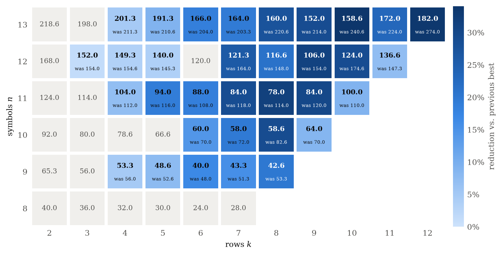
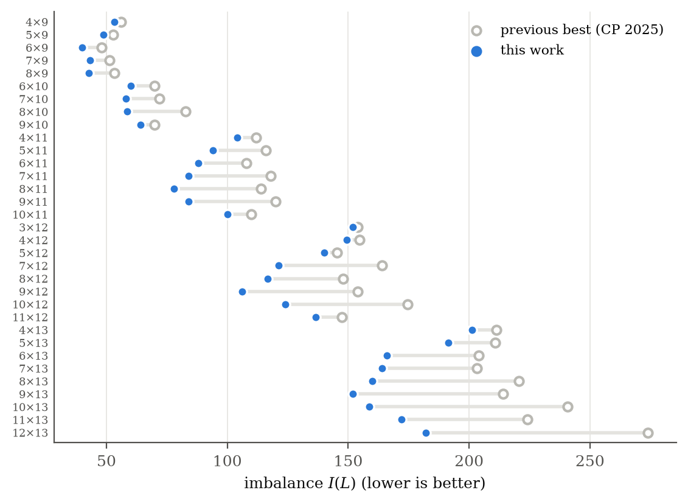
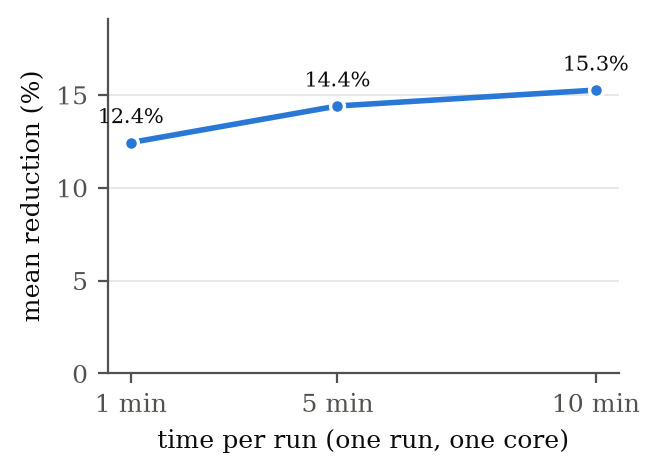

# Balanced Latin Rectangles: new best-known values

A simple simulated-annealing search improves the best known imbalance of **33 of the 51**
non-square instances (8 ≤ n ≤ 13) from
[Voboril, Peruvemba Ramaswamy & Szeider, CP 2025](https://doi.org/10.4230/LIPIcs.CP.2025.36),
and matches the other 18. Every rectangle is included and can be checked independently.

Paper: [`paper/main.pdf`](paper/main.pdf) — *Simple Local Search Sets 33 New Records for Balanced Latin Rectangles*.

<!-- RESULTS:START -->

## Results

**33 improved, 18 matched, 0 worse** out of 51 instances. Improvements average **18.3%** and reach **34.1%** (10×13: 240.6 → 158.6). Previous values are from Table 1 of CP 2025; all new values are verified by `code/verify.py`.

### At a glance



*New best imbalance per cell (bold, k across, n down) with the previous best below it, shaded by the reduction relative to the previous best. Grey cells match the previous value.*

### Full table

**Bold** = new best value from this work, with the previous best struck through. Plain = matched. Columns are k (rows of the rectangle), rows are n (symbols).

| n \ k | 2 | 3 | 4 | 5 | 6 | 7 | 8 | 9 | 10 | 11 | 12 |
|---:|:---:|:---:|:---:|:---:|:---:|:---:|:---:|:---:|:---:|:---:|:---:|
| **8** | 40.0 | 36.0 | 32.0 | 30.0 | 24.0 | 28.0 |  |  |  |  |  |
| **9** | 65.3 | 56.0 | **53.3** ~~56.0~~ | **48.6** ~~52.6~~ | **40.0** ~~48.0~~ | **43.3** ~~51.3~~ | **42.6** ~~53.3~~ |  |  |  |  |
| **10** | 92.0 | 80.0 | 78.6 | 66.6 | **60.0** ~~70.0~~ | **58.0** ~~72.0~~ | **58.6** ~~82.6~~ | **64.0** ~~70.0~~ |  |  |  |
| **11** | 124.0 | 114.0 | **104.0** ~~112.0~~ | **94.0** ~~116.0~~ | **88.0** ~~108.0~~ | **84.0** ~~118.0~~ | **78.0** ~~114.0~~ | **84.0** ~~120.0~~ | **100.0** ~~110.0~~ |  |  |
| **12** | 168.0 | **152.0** ~~154.0~~ | **149.3** ~~154.6~~ | **140.0** ~~145.3~~ | 120.0 | **121.3** ~~164.0~~ | **116.6** ~~148.0~~ | **106.0** ~~154.0~~ | **124.0** ~~174.6~~ | **136.6** ~~147.3~~ |  |
| **13** | 218.6 | 198.0 | **201.3** ~~211.3~~ | **191.3** ~~210.6~~ | **166.0** ~~204.0~~ | **164.0** ~~203.3~~ | **160.0** ~~220.6~~ | **152.0** ~~214.0~~ | **158.6** ~~240.6~~ | **172.0** ~~224.0~~ | **182.0** ~~274.0~~ |

### Every instance

Imbalance values; `x.3` and `x.6` mean x + 1/3 and x + 2/3. The last column links to the rectangle that achieves the new value.

| k × n | previous best | this work | change | reduction | status | rectangle |
|---|---:|---:|---:|---:|---|---|
| 2 × 8 | 40.0 | 40.0 | 0 | — | matched | [k2_n8.txt](results/rectangles/k2_n8.txt) |
| 3 × 8 | 36.0 | 36.0 | 0 | — | matched | [k3_n8.txt](results/rectangles/k3_n8.txt) |
| 4 × 8 | 32.0 | 32.0 | 0 | — | matched | [k4_n8.txt](results/rectangles/k4_n8.txt) |
| 5 × 8 | 30.0 | 30.0 | 0 | — | matched | [k5_n8.txt](results/rectangles/k5_n8.txt) |
| 6 × 8 | 24.0 | 24.0 | 0 | — | matched | [k6_n8.txt](results/rectangles/k6_n8.txt) |
| 7 × 8 | 28.0 | 28.0 | 0 | — | matched | [k7_n8.txt](results/rectangles/k7_n8.txt) |
| 2 × 9 | 65.3 | 65.3 | 0 | — | matched | [k2_n9.txt](results/rectangles/k2_n9.txt) |
| 3 × 9 | 56.0 | 56.0 | 0 | — | matched | [k3_n9.txt](results/rectangles/k3_n9.txt) |
| 4 × 9 | 56.0 | 53.3 | −2.6 | 4.8% | **improved** | [k4_n9.txt](results/rectangles/k4_n9.txt) |
| 5 × 9 | 52.6 | 48.6 | −4.0 | 7.6% | **improved** | [k5_n9.txt](results/rectangles/k5_n9.txt) |
| 6 × 9 | 48.0 | 40.0 | −8.0 | 16.7% | **improved** | [k6_n9.txt](results/rectangles/k6_n9.txt) |
| 7 × 9 | 51.3 | 43.3 | −8.0 | 15.6% | **improved** | [k7_n9.txt](results/rectangles/k7_n9.txt) |
| 8 × 9 | 53.3 | 42.6 | −10.6 | 20.0% | **improved** | [k8_n9.txt](results/rectangles/k8_n9.txt) |
| 2 × 10 | 92.0 | 92.0 | 0 | — | matched | [k2_n10.txt](results/rectangles/k2_n10.txt) |
| 3 × 10 | 80.0 | 80.0 | 0 | — | matched | [k3_n10.txt](results/rectangles/k3_n10.txt) |
| 4 × 10 | 78.6 | 78.6 | 0 | — | matched | [k4_n10.txt](results/rectangles/k4_n10.txt) |
| 5 × 10 | 66.6 | 66.6 | 0 | — | matched | [k5_n10.txt](results/rectangles/k5_n10.txt) |
| 6 × 10 | 70.0 | 60.0 | −10.0 | 14.3% | **improved** | [k6_n10.txt](results/rectangles/k6_n10.txt) |
| 7 × 10 | 72.0 | 58.0 | −14.0 | 19.4% | **improved** | [k7_n10.txt](results/rectangles/k7_n10.txt) |
| 8 × 10 | 82.6 | 58.6 | −24.0 | 29.0% | **improved** | [k8_n10.txt](results/rectangles/k8_n10.txt) |
| 9 × 10 | 70.0 | 64.0 | −6.0 | 8.6% | **improved** | [k9_n10.txt](results/rectangles/k9_n10.txt) |
| 2 × 11 | 124.0 | 124.0 | 0 | — | matched | [k2_n11.txt](results/rectangles/k2_n11.txt) |
| 3 × 11 | 114.0 | 114.0 | 0 | — | matched | [k3_n11.txt](results/rectangles/k3_n11.txt) |
| 4 × 11 | 112.0 | 104.0 | −8.0 | 7.1% | **improved** | [k4_n11.txt](results/rectangles/k4_n11.txt) |
| 5 × 11 | 116.0 | 94.0 | −22.0 | 19.0% | **improved** | [k5_n11.txt](results/rectangles/k5_n11.txt) |
| 6 × 11 | 108.0 | 88.0 | −20.0 | 18.5% | **improved** | [k6_n11.txt](results/rectangles/k6_n11.txt) |
| 7 × 11 | 118.0 | 84.0 | −34.0 | 28.8% | **improved** | [k7_n11.txt](results/rectangles/k7_n11.txt) |
| 8 × 11 | 114.0 | 78.0 | −36.0 | 31.6% | **improved** | [k8_n11.txt](results/rectangles/k8_n11.txt) |
| 9 × 11 | 120.0 | 84.0 | −36.0 | 30.0% | **improved** | [k9_n11.txt](results/rectangles/k9_n11.txt) |
| 10 × 11 | 110.0 | 100.0 | −10.0 | 9.1% | **improved** | [k10_n11.txt](results/rectangles/k10_n11.txt) |
| 2 × 12 | 168.0 | 168.0 | 0 | — | matched | [k2_n12.txt](results/rectangles/k2_n12.txt) |
| 3 × 12 | 154.0 | 152.0 | −2.0 | 1.3% | **improved** | [k3_n12.txt](results/rectangles/k3_n12.txt) |
| 4 × 12 | 154.6 | 149.3 | −5.3 | 3.4% | **improved** | [k4_n12.txt](results/rectangles/k4_n12.txt) |
| 5 × 12 | 145.3 | 140.0 | −5.3 | 3.7% | **improved** | [k5_n12.txt](results/rectangles/k5_n12.txt) |
| 6 × 12 | 120.0 | 120.0 | 0 | — | matched | [k6_n12.txt](results/rectangles/k6_n12.txt) |
| 7 × 12 | 164.0 | 121.3 | −42.6 | 26.0% | **improved** | [k7_n12.txt](results/rectangles/k7_n12.txt) |
| 8 × 12 | 148.0 | 116.6 | −31.3 | 21.2% | **improved** | [k8_n12.txt](results/rectangles/k8_n12.txt) |
| 9 × 12 | 154.0 | 106.0 | −48.0 | 31.2% | **improved** | [k9_n12.txt](results/rectangles/k9_n12.txt) |
| 10 × 12 | 174.6 | 124.0 | −50.6 | 29.0% | **improved** | [k10_n12.txt](results/rectangles/k10_n12.txt) |
| 11 × 12 | 147.3 | 136.6 | −10.6 | 7.2% | **improved** | [k11_n12.txt](results/rectangles/k11_n12.txt) |
| 2 × 13 | 218.6 | 218.6 | 0 | — | matched | [k2_n13.txt](results/rectangles/k2_n13.txt) |
| 3 × 13 | 198.0 | 198.0 | 0 | — | matched | [k3_n13.txt](results/rectangles/k3_n13.txt) |
| 4 × 13 | 211.3 | 201.3 | −10.0 | 4.7% | **improved** | [k4_n13.txt](results/rectangles/k4_n13.txt) |
| 5 × 13 | 210.6 | 191.3 | −19.3 | 9.2% | **improved** | [k5_n13.txt](results/rectangles/k5_n13.txt) |
| 6 × 13 | 204.0 | 166.0 | −38.0 | 18.6% | **improved** | [k6_n13.txt](results/rectangles/k6_n13.txt) |
| 7 × 13 | 203.3 | 164.0 | −39.3 | 19.3% | **improved** | [k7_n13.txt](results/rectangles/k7_n13.txt) |
| 8 × 13 | 220.6 | 160.0 | −60.6 | 27.5% | **improved** | [k8_n13.txt](results/rectangles/k8_n13.txt) |
| 9 × 13 | 214.0 | 152.0 | −62.0 | 29.0% | **improved** | [k9_n13.txt](results/rectangles/k9_n13.txt) |
| 10 × 13 | 240.6 | 158.6 | −82.0 | 34.1% | **improved** | [k10_n13.txt](results/rectangles/k10_n13.txt) |
| 11 × 13 | 224.0 | 172.0 | −52.0 | 23.2% | **improved** | [k11_n13.txt](results/rectangles/k11_n13.txt) |
| 12 × 13 | 274.0 | 182.0 | −92.0 | 33.6% | **improved** | [k12_n13.txt](results/rectangles/k12_n13.txt) |

### Size of each improvement



*Previous best (open circles) and new value (filled) for each improved instance. Gains grow with instance size.*

### Effect of the time budget



*Mean reduction relative to the previous best over the 32 instances run at all three budgets (k ≥ 4, n ≥ 9). One single-threaded run per budget, each with a different seed. Longer runs widen the margin; the table gives the exact numbers.*

| time per run | 1 min | 5 min | 10 min |
|---|---:|---:|---:|
| mean reduction | 12.4% | 14.4% | 15.3% |
| instances improved | 29 / 32 | 29 / 32 | 29 / 32 |

<!-- RESULTS:END -->

## Check the records (no build needed)

```sh
python3 code/verify.py
```

This reads every rectangle in `results/rectangles/`, checks that it is a Latin rectangle, recomputes
its imbalance with exact rational arithmetic, and compares it with `results/results.csv`.
The checker shares no code with the solver and needs only the Python standard library.
To check a single file: `python3 code/verify.py results/rectangles/k12_n13.txt`.

**Definition** ([Ramaswamy & Szeider, CP 2023](https://doi.org/10.4230/LIPIcs.CP.2023.48)): for a
k × n Latin rectangle with c_i(u) the column of symbol u in row i,
d(u,v) = Σ_i |c_i(u) − c_i(v)| and I(L) = Σ_{u<v} |d(u,v) − k(n+1)/3|.
Values like `158.6` mean 158 + 2/3, and `.3` means + 1/3, as in the literature.

## Repository layout

| Path | Contents |
|---|---|
| `results/rectangles/` | Best rectangle for every cell (`k{k}_n{n}.txt`, symbols 1..n, one row per line) |
| `results/results.csv` | Previous best vs. new value for every cell (`imbalance3` = 3·I, exact integer) |
| `results/budget.csv` | Best value per cell for each time budget |
| `results/raw/` | Raw solver output of every run |
| `data/previous_best.csv` | Baseline: CP 2025, Table 1 |
| `code/sa.c` | The search (simulated annealing, about 130 lines of C) |
| `code/verify.py` | Independent checker |
| `code/collect.py` | Verifies all raw runs and builds `results/` |
| `code/plots.py`, `code/make_tables.py`, `code/make_readme.py` | Figures, the paper's table and numbers, and this README's results section |
| `code/run_all.sh` | Reproduces every run (about 1.5 hours on 8 cores) |
| `paper/` | LaTeX source and PDF |

## Reproduce

```sh
cd code
./run_all.sh                 # build, run all budgets, collect, verify
python3 plots.py             # figures (needs matplotlib)
python3 make_tables.py       # paper/table.tex and paper/numbers.tex
python3 make_readme.py       # results section of this README
cd ../paper && tectonic main.tex   # or: pdflatex + bibtex
```

Single run: `./sa k n seconds seed` prints `COST3 <3·I>` followed by the rectangle.
Runs measure CPU time and are single-threaded. Results depend on the seed and the machine speed,
so a rerun will not reproduce the exact rectangles, but it should give values of similar quality.

## Scope and caveats

- The new values are **upper bounds**. Optimality is open for every improved instance.
- One run per cell and time budget. No variance across seeds is reported.
- The comparison with CP 2025 uses their reported results. We did not rerun their pipeline.
